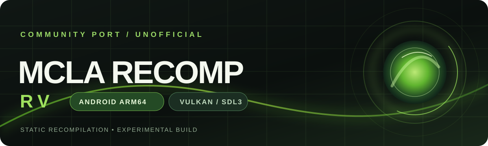

# MCLA Recomp RV

An experimental native Android ARM64 port of *Midnight Club: Los Angeles Complete Edition* for Xbox 360. The project uses C++23, SDL3 and Vulkan through the ReXGlue runtime; it is not an x86 emulator or a Linux compatibility layer.

## Status

The port reaches menus, audio and 3D gameplay on a Samsung Galaxy S23 (Adreno 740, 8 GB RAM, 256 GB storage). System Vulkan is the recommended driver on the tested phone. Optional Turnip packages load, but the tested variants still produce a rear-light flashing artifact. Sustained FPS is low and stutters remain. See the consolidated [Android status](docs/android-status.md) and [known issues](KNOWN-ISSUES.md).

The public Android release is experimental and debug-signed. Its APK still contains generated native game code; the source repository never contains game data, generated game sources, saves, keys, driver packages or shader packs. A source-only release is the preferred future distribution and requires a separate release decision.

## Build

The reproducible source recipe is in [docs/android-build.md](docs/android-build.md). It pins ReXGlue SDK commit `f5337cdc947ff6d4c4196737e2c807a48f2a1fc2` and applies the three Android patches in `patches/`. The Android CI builds the patched SDK and performs a host syntax check without game files. This repository does not provide the game data.

## Install and import data

Provide your own legally obtained Xbox 360 game data, extract the 13 required files, and import the extracted folder through the Android document picker. The detailed steps and optional Turnip-driver guidance are in [docs/android-testing.md](docs/android-testing.md). No broad storage permission is required for the picker. Logs are exported to `Documents/MCLA/logs/` when Android supports MediaStore.

## Limitations

- Only ARM64 Android is supported; 16 KiB page-device runtime and clean-profile folder import remain unverified.
- System Vulkan is currently safer than the optional Turnip path on the tested device.
- Gamepad is the only officially supported input method at the moment. Keyboard
  and mouse may work through Android/SDL but are not verified; touch input is
  planned for a future update.
- The launcher checks file presence and nonzero size, not content hashes.
- No game image, game assets, saves, signing keys, generated game code or third-party driver is distributed by this source repository.

## Credits and license

This work builds on [holdmysocks/mcla-recomp](https://github.com/holdmysocks/mcla-recomp), the direct [RenanQueiroz fork](https://github.com/RenanQueiroz/mcla-recomp), ReXGlue, SDL3 and AdrenoTools. [CREDITS.md](CREDITS.md) records provenance and the AI assistance used during development; [THIRD-PARTY-NOTICES.md](THIRD-PARTY-NOTICES.md) contains required notices. The project is licensed under [GPL-3.0-or-later](LICENSE) and is not affiliated with the game rights holders.

The original game and its data remain the property of their respective owners. Do not upload game files, generated code or private artifacts to this repository.
