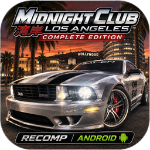

  

  

<h3 align="center">Midnight Club: Los Angeles Complete Edition — Recompiled for Android</h3>

  Native C++23 ARM64 Recompilation &nbsp;•&nbsp; Adreno / Turnip Vulkan &nbsp;•&nbsp; Xbox 360 Touch HUD + Analog <code>%</code> Pedals &nbsp;•&nbsp; Stereo Anti-Cut Audio

  
  
  
  
  

  
  &nbsp;
  
  &nbsp;
  

  <a href="#highlights">Highlights</a> &nbsp;•&nbsp;
  <a href="#releases">Builds</a> &nbsp;•&nbsp;
  <a href="#quick-start">Quick Start</a> &nbsp;•&nbsp;
  <a href="#compatibility">Compatibility</a> &nbsp;•&nbsp;
  <a href="#need-help">Support &amp; Logs</a> &nbsp;•&nbsp;
  <a href="#documentation">Docs</a> &nbsp;•&nbsp;
  <a href="#source-availability">Source</a>

Maintainer: <a href="https://github.com/gabrielbskk"><strong>gabrielbskk</strong></a> &nbsp;·&nbsp; Discord: <code>gabrielbskk</code>

---

> [!WARNING]
> **Development is paused and this repository is archived.** I have made no further progress and may return to the project someday, but there is no restart timeline. The project required substantial time and expenses without the positive results I had hoped for. This repository remains as an archive; active development and support have stopped.

> [!IMPORTANT]
> **Bring your own legally obtained Xbox 360 game files.** This APK contains only recompiled native ARM64 host code and launcher UI — no game assets, RPF/BIK archives, shader packs, or Turnip drivers are bundled.

## What's New in `v0.1.64` *(Experimental)*

| Area | What Changed |
| :--- | :--- |
| **Snapdragon FPS Presets & Empty Streets** | Selectable **S23 Balanced** *(default)*, **Max FPS / Low Draw-Call**, and **Console Visuals** profiles + one-tap **Empty Streets** toggle (`mcla_empty_streets`) to eliminate heavy off-screen shadow cascades, blurs, and ambient traffic stalls under Turnip `syncdraw`. |
| **Qualcomm System Vulkan Fix** | Disabled unconditional `VK_EXT_debug_utils` messenger attachment when validation is off — eliminating the **1,000+ `VKDBGUTILWARN003` callbacks/sec** driver & I/O storm found in Snapdragon system-driver logs (Zenfone 9, S23, 8 Elite). |
| **S23 & RedMagic 11 Air Audio Engine** | Host `setpriority` boost for **Audio Worker** & **XMA Decoder**, lock-free 6ch → 2ch stereo SDL3 callback, and dedicated **RedMagic / 8 Elite Safe (`20–32` frames)** & **S23 Adaptive (`16–28` frames)** anti-cut profiles. |
| **Xbox 360 HUD & `%` Pedals** | Redesigned Midnight LA Launcher, official **MCLA Recomp Android** app icon, authentic Xbox 360 `A`/`B`/`X`/`Y` jewel buttons & concave 4-dot sticks, plus **vertical `GAS` (`RT`) / `BRK` (`LT`) pedals** with live `0%–100%` pressure readout (higher = stronger force, lower = gentler throttle). |
| **Self-Healing Diagnostic Logs** | Automatic 15-second background export + pause/exit flush to `Documents/MCLA/logs/MCLA-diagnostic.txt` and `mcla-current.txt`, plus a manual **Export Diagnostic Log Now** button. |

## 01 · Snapdragon / Adreno Builds

Download APKs from [Releases](https://github.com/gabrielbskk/mcla-recomp-rv/releases):

| Build | Target Hardware | Summary |
| :--- | :--- | :--- |
| **`v0.1.64`** · *Experimental* | Snapdragon / Adreno *(8 GB+ RAM recommended)* | **Latest community test build.** Redesigned Launcher & Xbox 360 `%` pedals, `S23 Balanced` / `Max FPS` / `Empty Streets` modes, RedMagic 11 Air + S23 anti-cut audio fix, Qualcomm `VKDBGUTILWARN003` fix, repaired live log exporter, and new app icon. |
| **`v0.1.63`** · *Experimental* | Snapdragon / Adreno | Restored 720p full-screen scaling, Turnip `TU_DEBUG=syncdraw` wheel/light flicker fix, persistent `VkPipelineCache`, and S23 thermal mode. |
| **`v0.1.61`** · *Baseline* | Snapdragon / Adreno | Earlier snapshot prior to the `v0.1.62+` renderer, audio, and HUD overhaul. |

**Mali / Immortalis / PanVK support is discontinued.** Tested non-Adreno GPUs lack required Vulkan pipeline features and hit Android swapchain incompatibilities outside this port's scope; see the [Mali technical note](docs/android-mali-driver.md) and [release details](docs/android-release.md).

## 02 · Quick Start

1. **Install the APK** from [Releases](https://github.com/gabrielbskk/mcla-recomp-rv/releases). Upgrading over an existing install (`pm install -r` or standard Android package update) preserves all imported game files and career saves.
2. **Import your 13 game files** extracted from your Xbox 360 *Midnight Club: Los Angeles Complete Edition* copy (~**6.2 GB** free private storage required). Full step-by-step instructions are in [docs/android-testing.md](docs/android-testing.md).
3. **Pick your Driver & Preset:**
   - **Turnip Freedreno (`.zip`):** Keeps `TU_DEBUG=syncdraw` enabled by default to prevent wheel & headlight flickering on Adreno 7xx; pair with **S23 Balanced** or **Max FPS** (+ **Empty Streets** if desired).
   - **Qualcomm System Vulkan:** Works out of the box (especially on Adreno 8xx / Snapdragon 8 Elite where Turnip support varies), now free of `VKDBGUTILWARN003` debug-callback overhead.
4. **Customize Controls & Launch:** Adjust your Xbox 360 touch HUD, pedal size/opacity, or connect a Bluetooth/USB controller, then tap **LAUNCH MIDNIGHT CLUB: LA**.

> [!WARNING]
> **Never uninstall or clear app data when updating** — doing so deletes your imported `game/` folder and saves inside app-private storage. Always install updates directly on top (`pm install -r`).

## 03 · Multi-Device Investigation & Compatibility

Results from maintainer testing and community diagnostic log analysis (`v0.1.24`–`v0.1.64`):

| Device & SoC | RAM | Findings & `v0.1.64` Status | Source |
| :--- | :--- | :--- | :--- |
| **Samsung Galaxy S23** · Snapdragon 8 Gen 2 (`Adreno 740`) | 8 GB | Primary development target. Turnip `syncdraw` fixes wheel/light flicker; `v0.1.64` adds **S23 Balanced**, **Empty Streets**, lock-free stereo audio, and 240 Hz touch/pedal optimizations. | Maintainer |
| **RedMagic 11 Air** · Snapdragon 8 Elite (`Adreno 830`) | 12–16 GB | Earlier logs showed 6-ch endpoint overhead + `8`-frame queue underruns during shader stalls and unraised audio threads. `v0.1.64` auto-enables **RedMagic Safe (`20–32` frames, `1024` buf)** + host audio priority. | Tester logs |
| **Asus Zenfone 9** · Snapdragon 8+ Gen 1 (`Adreno 730`) | 6–8 GB | Multi-session logs (`225 MB`) revealed Qualcomm's system Vulkan firing 1,000+ `VKDBGUTILWARN003` debug callbacks/sec. **Fixed in `v0.1.64`**; use **S23 Balanced** or **Max FPS**. | [Issue #5](https://github.com/gabrielbskk/mcla-recomp-rv/issues/5) + Drive logs |
| **Samsung Galaxy Z Fold 5** · Snapdragon 8 Gen 2 (`Adreno 740`) | 12 GB | `v0.1.24` hit an early import/file-I/O issue; retest welcome on `v0.1.64`. | [Issue #6](https://github.com/gabrielbskk/mcla-recomp-rv/issues/6) |
| **Motorola Moto G34 5G** · Snapdragon 695 (`Adreno 619`) | 4 GB | Below practical hardware floor: `3.4 GB` usable RAM hits heavy zram swap (`<700 MB` free) and `4–6 FPS` on Vulkan `1.1`. **8 GB+ RAM & Adreno 7xx/8xx recommended.** | Drive logs |
| **Mali / Immortalis / Xclipse** | Any | Unsupported; diagnostic builds discontinued. | [Technical note](docs/android-mali-driver.md) |

For deeper historical notes and methodology, read [docs/android-compatibility.md](docs/android-compatibility.md).

## 04 · Need Help or Reporting a Bug?

Check [KNOWN-ISSUES.md](KNOWN-ISSUES.md) first, then open an [Issue](https://github.com/gabrielbskk/mcla-recomp-rv/issues) or message **`gabrielbskk`** on Discord with:

1. **Device model, SoC, RAM, Android version**, and **APK version** (`v0.1.64`).
2. **Active Vulkan driver** (`System Vulkan` or exact `Turnip` ZIP version + `TU_DEBUG` mode) and selected **Performance / Audio preset**.
3. **Diagnostic log:** attach `Documents/MCLA/logs/MCLA-diagnostic.txt` (or tap **Export Diagnostic Log Now** inside the launcher). Never share copyrighted game files or personal data.

## 05 · Documentation

| Player Guides | Project Reference |
| :--- | :--- |
| [Installation & Folder Import](docs/android-testing.md) | [Experimental Changelog](CHANGELOG.md) |
| [Compatibility & Hardware Notes](docs/android-compatibility.md) | [Android Port Status](docs/android-status.md) |
| [Release Notes & SHA-256 Hashes](docs/android-release.md) | [Why Mali Support Ended](docs/android-mali-driver.md) |
| [Known Issues](KNOWN-ISSUES.md) | [Security Policy](SECURITY.md) |

## About the Project

**MCLA Recomp RV** uses static Xbox 360 PowerPC → C++23 recompilation powered by **ReXGlue**, **SDL3**, **Vulkan**, and **AdrenoTools** — it is not an x86/PC emulator or an official Rockstar release. Review [SECURITY.md](SECURITY.md) before loading third-party `.zip` GPU drivers.

Built upon [holdmysocks/mcla-recomp](https://github.com/holdmysocks/mcla-recomp), the [RenanQueiroz fork](https://github.com/RenanQueiroz/mcla-recomp), ReXGlue, SDL3, and AdrenoTools under [GPL-3.0-or-later](LICENSE).

## Source Availability

Complete host application, Android launcher/HUD, build scripts, and the 14-patch ReXGlue SDK series are publicly available under **GPL-3.0-or-later** at [**gabrielbskk/mcla-recomp-source**](https://github.com/gabrielbskk/mcla-recomp-source). GitHub Issues are disabled on the source repository so all bug reports, logs, and player discussions remain centralized in [**mcla-recomp-rv/issues**](https://github.com/gabrielbskk/mcla-recomp-rv/issues).

[Credits](CREDITS.md) &nbsp;·&nbsp; [Third-Party Notices](THIRD-PARTY-NOTICES.md)

<strong>Full Project Cover Artwork</strong>

  

---

  Community static recompilation project. Not affiliated with Rockstar Games, Take-Two Interactive, or the game's rights holders. 
  <a href="#top">Back to top ↑</a>

