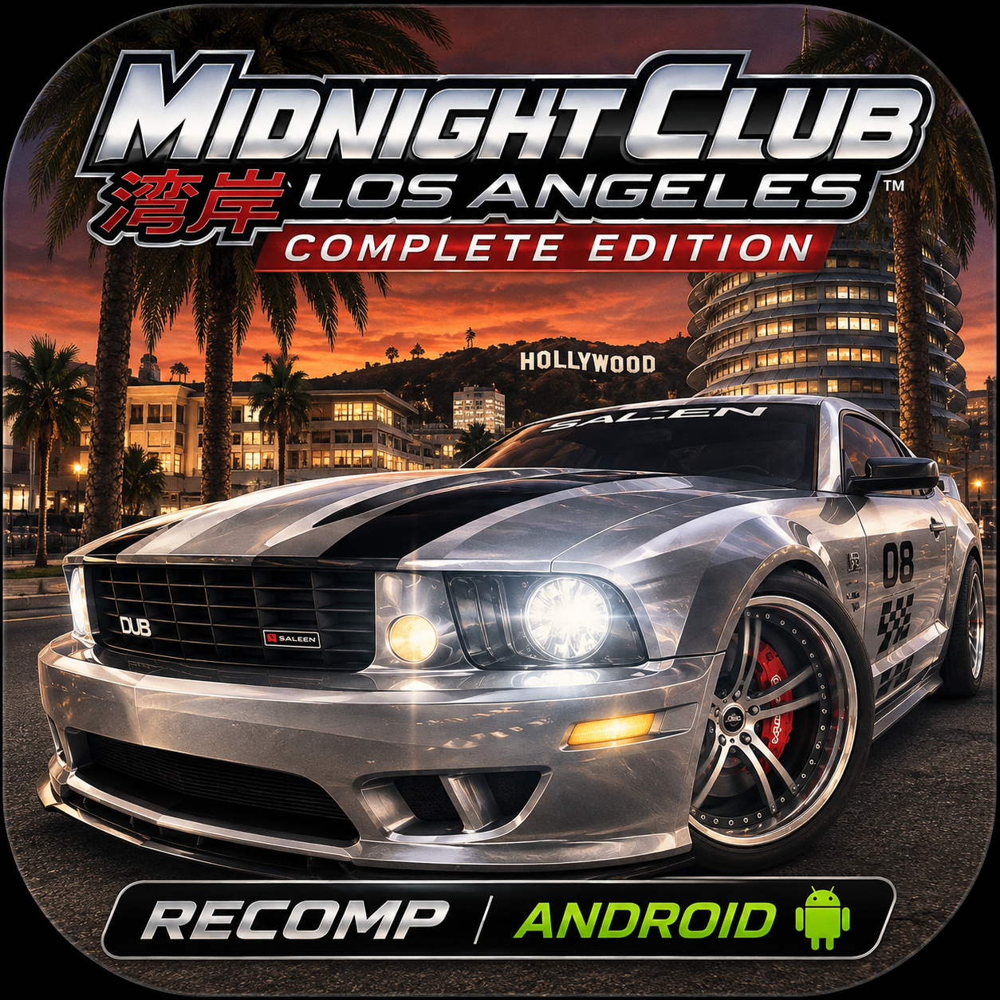
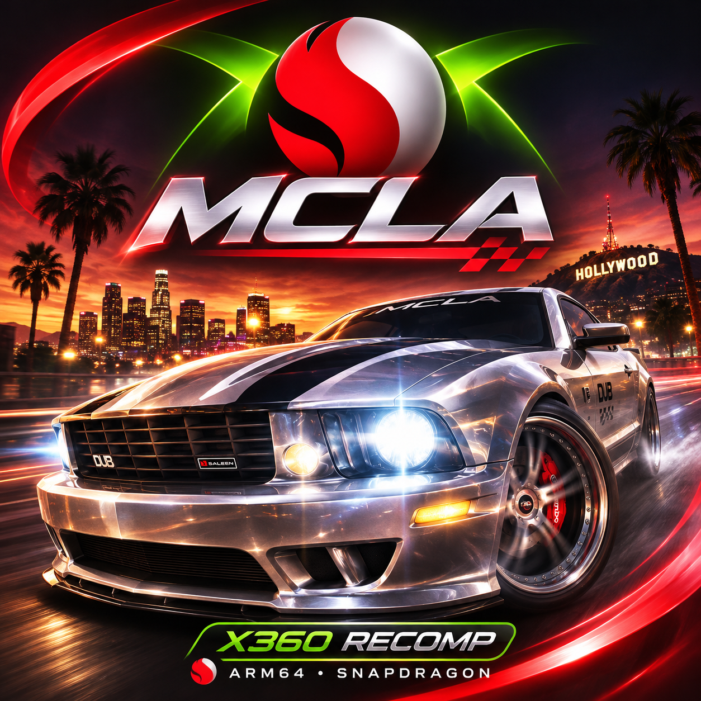
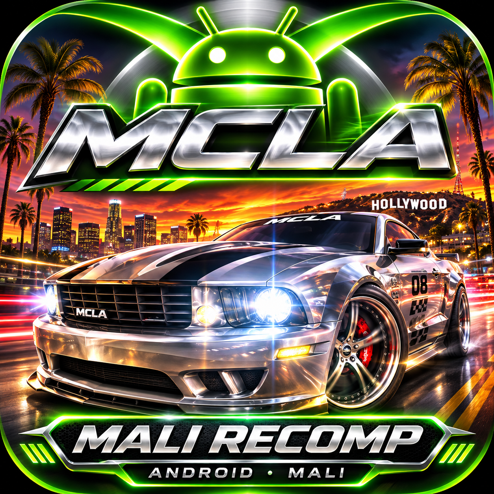

  

<h1 align="center">MCLA RECOMP RV</h1>

<strong>LOS ANGELES, RECOMPILED.</strong> 
An unofficial Android ARM64 port of <em>Midnight Club: Los Angeles Complete Edition</em> for Xbox 360.

  <a href="https://github.com/gabrielbskk/mcla-recomp-rv/releases/tag/android-arm64-v0.1.15"><strong>DOWNLOAD v0.1.15</strong></a>
  &nbsp; · &nbsp;
  <a href="docs/android-testing.md">INSTALL &amp; PLAY</a>
  &nbsp; · &nbsp;
  <a href="docs/android-build.md">BUILD FROM SOURCE</a>

---

### 01 / THE DRIVE

Static recompilation brings the Xbox 360 game to native ARM64 using C++23,
SDL3, Vulkan and the ReXGlue runtime. This is **not** an x86 emulator, a
Linux compatibility layer, or an official release.

| Tested on | Graphics | Current state |
| :--- | :--- | :--- |
| Galaxy S23 · Snapdragon 8 Gen 2 · Adreno 740 · 8 GB RAM | System Vulkan or optional Turnip 27 | Menus, audio and driving work; performance and compatibility vary |

The system Vulkan driver avoids the artifacts seen with Turnip on this device,
but was slower in tested runs. With the tested Turnip 27 build, rear lights and
wheels flicker unless the diagnostic `TU_DEBUG=syncdraw` switch is applied
before launch; it is **not enabled by default** and currently requires access
to the app-private `files/driver.env` (typically root). Stutters and thermal
slowdown remain. See the [A740 test matrix](docs/turnip-a740-rendering-artifacts.md),
[known issues](KNOWN-ISSUES.md) and [Android status](docs/android-status.md).

### Device variants

<table>
  <tr>
    <th>Snapdragon / Adreno</th>
    <th>Mali (diagnostic only)</th>
  </tr>
  <tr>
    <td align="center"></td>
    <td align="center"></td>
  </tr>
  <tr>
    <td>Galaxy S23 gameplay validated. <a href="https://github.com/gabrielbskk/mcla-recomp-rv/releases/tag/android-arm64-v0.1.15">Download v0.1.15</a>.</td>
    <td>Experimental local diagnostic APK; no Mali gameplay validation or public release yet. Mali-G720 MC7 and Mali-G52 MC2 logs report a missing Vulkan feature.</td>
  </tr>
</table>

### 02 / GET ON THE ROAD

1. Download the **ARM64 APK** from the [v0.1.15 release](https://github.com/gabrielbskk/mcla-recomp-rv/releases/tag/android-arm64-v0.1.15).
2. Supply the 13 extracted files from **your own legally obtained Xbox 360 copy**.
   The game data is not included; the import needs about 6.2 GB of free
   destination space in addition to your extracted source files.
3. Follow [the installation and import guide](docs/android-testing.md).

**Controls:** A single gamepad is the only validated in-game input method.
Keyboard and mouse may work, but have not been tested. Touch controls are
not supported yet; there are no on-screen driving controls.

The APK is **debug-signed** and includes a native library generated from the
game executable, but no extracted game assets, saves, Turnip package, shader
pack or signing key. It has been tested on a limited set of devices; clean-profile
import and 16 KiB memory-page runtime are not yet verified. The source
repository does **not** include game data, generated code, APKs or private
artifacts. Do not clear app data when updating if you want to keep your imported
game and saves.

**Logs:** Open `Documents/MCLA/logs/` in a file manager for the exported
`.txt` logs. The app keeps its original `.log` files privately under
`files/logs/`; reopen the launcher if a log was not exported after a crash.

### 03 / UNDER THE HOOD

The [Android build recipe](docs/android-build.md) pins ReXGlue SDK commit
`f5337cdc947ff6d4c4196737e2c807a48f2a1fc2` and applies the Android
patches in `patches/`. Push CI checks the repository; pull requests and manual
CI runs also build the patched SDK and check the host source without game
files. See the [release notes](docs/android-release.md)
for the APK hash, device test scope and remaining limitations.

---

<strong>COMMUNITY PROJECT · UNOFFICIAL PORT</strong>

This work builds on [holdmysocks/mcla-recomp](https://github.com/holdmysocks/mcla-recomp),
the [RenanQueiroz fork](https://github.com/RenanQueiroz/mcla-recomp), ReXGlue,
SDL3 and AdrenoTools. [Credits and provenance](CREDITS.md) ·
[Third-party notices](THIRD-PARTY-NOTICES.md) · [GPL-3.0-or-later](LICENSE).
This project is not affiliated with the game's rights holders. The original
game and its data remain the property of their respective owners.
