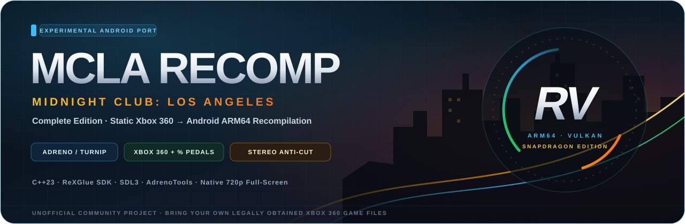
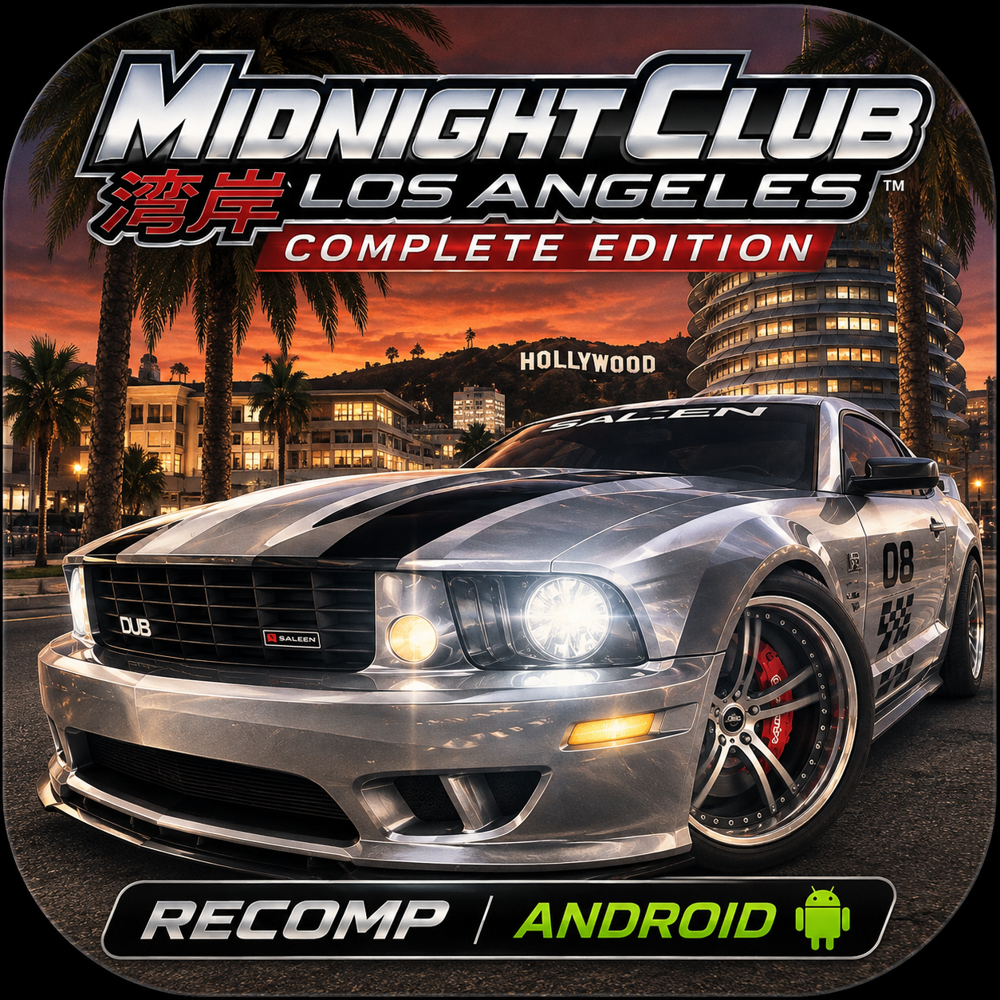

  

  <strong>From Xbox 360 to Android. A community-driven recompilation.</strong> 
  Native ARM64 code · Vulkan graphics · Controller support · Experimental touch controls

  
  
  
  

  
  &nbsp;
  

  <a href="#compatibility">Compatibility</a> &nbsp; / &nbsp;
  <a href="#need-help">Support</a> &nbsp; / &nbsp;
  <a href="#documentation">Documentation</a> &nbsp; / &nbsp;
  <a href="CHANGELOG.md">Changelog</a>

Maintainer: <a href="https://github.com/gabrielbskk">gabrielbskk</a> · Discord: <strong>gabrielbskk</strong>

---

> [!NOTE]
> **Active development has resumed.** This repository is the public distribution
> channel hosting Android releases, [changelogs](CHANGELOG.md), player
> documentation, and issue tracking. Current work focuses on Snapdragon / Adreno
> performance, thermal stability, and Vulkan rendering fixes (tested primarily on
> Galaxy S23). Application and SDK source code are maintained separately; see
> [Source availability](#source-availability).

> [!IMPORTANT]
> **Early Android port — compatibility and performance vary.** You need your
> own legally obtained Xbox 360 game files; they are not included.

## 01 · Snapdragon / Adreno build

Download the APK from [Releases](https://github.com/gabrielbskk/mcla-recomp-rv/releases):

| APK | Intended device | Status |
| --- | --- | --- |
| **v0.1.63** · experimental | Snapdragon / Adreno | **Experimental test build.** Full-screen presentation restored, Turnip `syncdraw` default restored (fixes wheel & headlight flicker), persistent Vulkan pipeline cache, native zero-Vulkan-cost FPS HUD, stereo audio, and Galaxy S23 thermal/GPU fixes. |
| **v0.1.61** · normal | Snapdragon / Adreno | Stable baseline. Auto log export, launcher cleanup. No frame generation. |

**Mali support has been discontinued.** The diagnostic APK has been withdrawn;
Mali/Immortalis and PanVK are outside this project's supported scope. Tested
devices hit required Vulkan-feature and Android swapchain incompatibilities.
Supporting them would require substantial renderer/platform work, not just a
driver switch. This is a development-scope decision, not proof that the entire
project must be rewritten. See the [retirement note](docs/android-mali-driver.md).

The RedMagic / 8 Elite diagnostic is withheld while reported audio cuts are
investigated. See [release details and hashes](docs/android-release.md).

## 02 · Get on the road

1. **Install.** Download the Android ARM64 APK from [Releases](https://github.com/gabrielbskk/mcla-recomp-rv/releases).
2. **Import.** Extract the 13 files from your own game copy and select their folder
   in the launcher. Allow about **6.2 GB** for the imported copy, plus source files
   and cache space. Follow the [installation guide](docs/android-testing.md).
3. **Launch.** Start with the **system Vulkan driver**. Optionally import a
    **trusted** Turnip ZIP for Adreno; imported drivers run native code.
4. **Tune.** Adjust visual settings in the game's **Options / Display** menu.
   The launcher's driver selector is separate. Touch controls and their editor
   are experimental; one gamepad is the validated input method.

> [!WARNING]
> **Keep your game files and saves:** compatible updates replace the existing
> app. Use `pm install -r`; **do not uninstall or
> clear data**. Downgrades can be rejected by Android.

## Compatibility

**Device reports, not guarantees.** Results below distinguish maintainer testing
from community reports.

| Device | Result | Source |
| --- | --- | --- |
| Galaxy S23 · Snapdragon 8 Gen 2 · 8 GB | v0.1.61 reportedly performs well; no controlled FPS measurement. | Maintainer test |
| Zenfone 9 · Snapdragon 8+ Gen 1 · 6 GB | Older builds ran with reported freezes and lag; 5–15 FPS estimated, not benchmarked. | [Tester · #5](https://github.com/gabrielbskk/mcla-recomp-rv/issues/5) |
| Galaxy Z Fold 5 · Snapdragon 8 Gen 2 · 12 GB | v0.1.24 reached a file-I/O error; no confirmed gameplay or v0.1.61 retest. | [Tester · #6](https://github.com/gabrielbskk/mcla-recomp-rv/issues/6) |
| Mali / Immortalis devices | Unsupported; diagnostic distribution discontinued. | [Technical note](docs/android-mali-driver.md) |
| RedMagic 11 Air · Snapdragon 8 Elite | Stereo audio logged, but cuts reported; gameplay and FPS unverified. | Tester report |

<strong>About older performance measurements</strong>

Older S23 runs measured 14.223 presented FPS on system Vulkan and 22–24 FPS
in a separate Turnip run. They used different settings and thermal conditions:
**they are not a controlled comparison or v0.1.61 benchmarks**. For evidence,
device details and likely requirements, see [compatibility and performance](docs/android-compatibility.md).

## Need help?

Check the [known issues](KNOWN-ISSUES.md) before opening a
[bug report](https://github.com/gabrielbskk/mcla-recomp-rv/issues). Include:

- Phone model, GPU, Android version and APK version.
- Driver name/version and a short description of how to reproduce the problem.
- An exported log; review it for personal information before sharing.

Shared logs are exported to `Documents/MCLA/logs/` on Android 10+; reopen the
launcher after a crash if necessary. Never upload game files or saves.

## Documentation

| For players | Project |
| --- | --- |
| [Installation and testing](docs/android-testing.md) | [Changelog](CHANGELOG.md) |
| [Compatibility and performance](docs/android-compatibility.md) | [Android status](docs/android-status.md) |
| [Release notes and hashes](docs/android-release.md) | [Mali support discontinued](docs/android-mali-driver.md) |
| [Known issues](KNOWN-ISSUES.md) | [Security policy](SECURITY.md) |

## About the project

This project uses static recompilation, C++23, SDL3, Vulkan and ReXGlue; it is
not an x86 emulator or an official release. APKs are debug-signed and contain a
native library generated from the game executable, but no extracted game
assets, saves, shader pack, driver ZIP or signing key. See the
[security policy](SECURITY.md) before importing third-party drivers or sharing
logs.

Built on [holdmysocks/mcla-recomp](https://github.com/holdmysocks/mcla-recomp),
the [RenanQueiroz fork](https://github.com/RenanQueiroz/mcla-recomp), ReXGlue,
SDL3 and AdrenoTools. This unofficial project is not affiliated with the game's
rights holders. The project is licensed under [GPL-3.0-or-later](LICENSE).

## Source availability

Application and SDK source code are not published in this repository. The
project is licensed under GPL-3.0-or-later, so the corresponding source for
every published build is available on written request: open an issue titled
`Source request` (or contact the maintainer on Discord, `gabrielbskk`) and
include the release version you downloaded. Requests are honoured for at least
three years from the release date, as required by GPLv3 §6(b).

Game assets, extracted game files, saves, shader packs, driver ZIPs and signing
keys are never part of any build and are never distributed.

[Credits](CREDITS.md) · [Third-party notices](THIRD-PARTY-NOTICES.md)

Project cover artwork

  

---

Built by the community. Not affiliated with Rockstar Games or the game's rights holders. <a href="#top">Back to top ↑</a>

